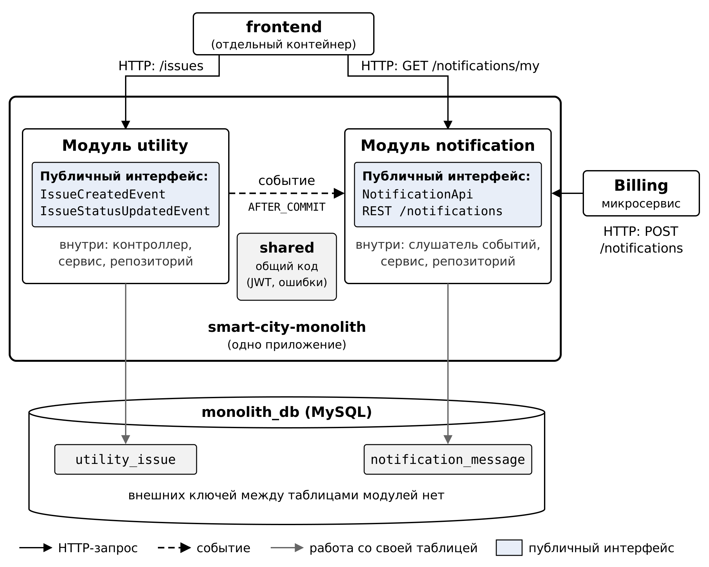

# City Infrastructure Platform: Modular Monolith

**Учебный проект** «Умный город»: реализация **модульного монолита** (лабораторная работа 2).

Этот репозиторий содержит объединённое приложение `smart-city-monolith`, в котором два микросервиса (`utility-service` и `notification-service`) перенесены в один процесс как модули. Остальные сервисы (`auth`, `transport`, `environment`, `billing`) остаются микросервисами, `frontend` остается отдельным контейнером; все они запускаются вместе с монолитом одной командой.

> **Исходный микросервисный проект:** [city-infrastructure](https://github.com/Darya-Rusanova/city-infrastructure)
>
> Общая информация о проекте, стеке, команде и сквозном сценарии находится в README микросервисного репозитория. Здесь описано только то, что касается модульного монолита.

## Команда

| Участник | Зона ответственности |
|---|---|
| Русанова Дарья | Модуль utility, Docker |
| Бойченко Ксения | Модуль notification, проверка frontend, схема модулей |
| Яманова Ульяна | Замеры, эксперимент с отказом |
| Агеева Александра | SQL-скрипты, сборка отчета |

## Что изменилось по сравнению с микросервисами

| Было (микросервисы) | Стало (модульный монолит) |
|---|---|
| `utility-service` (отдельный контейнер) | Модуль `modules/utility` внутри монолита |
| `notification-service` (отдельный контейнер) | Модуль `modules/notification` внутри монолита |
| HTTP-вызов `POST /notifications` между ними | Внутреннее событие Spring (`ApplicationEventPublisher`) |
| Две БД (`utility_db`, `notification_db`) | Одна БД `monolith_db` с префиксами таблиц |
| 13 контейнеров | 11 контейнеров |
| Порты `utility-service`: 8083, `notification-service`: 8086 | Порт монолита: 8090 |

**Внешний REST API не изменился.** Пути, форматы запросов и ответов, коды и роли те же (`/issues`, `/notifications/my`, `POST /notifications`). Фронтенд и Billing работают с монолитом без изменения кода, в `docker-compose.yml` изменены только адреса в переменных `UTILITY_SERVICE_URL` и `NOTIFICATION_SERVICE_URL`.

`POST /notifications` оставлен, хотя utility больше его не вызывает: его по-прежнему вызывает Billing, который остался отдельным микросервисом.

### Способ взаимодействия: вариант Б (события)

Модуль utility публикует событие при создании заявки и смене статуса. Модуль notification ловит его и сохраняет уведомление.

Почему вариант Б:
- utility не знает о notification: слабая связность.
- При выделении notification обратно в микросервис достаточно заменить ApplicationEventPublisher на брокер сообщений.
- Ошибка уведомления не ломает основную операцию: AFTER_COMMIT + try/catch.

### Границы модулей

- utility не импортирует ничего из modules.notification.
- notification импортирует из utility только modules.utility.event (DTO событий).
- Публичный интерфейс notification для других модулей: `NotificationApi`.

## Единая база данных

Одна БД monolith_db. Таблицы с префиксами модулей, без внешних ключей между модулями:

| Модуль | Таблица |
|---|---|
| utility | utility_issue |
| notification | notification_message |

SQL-скрипты (`sql/01-utility.sql`, `sql/02-notification.sql`) создают структуру и тестовые данные: три заявки и пять уведомлений к ним. Скрипты выполняются только при первом запуске (пустой том БД). Чтобы выполнить их заново, удалить тома: `docker compose down -v`.

## Схема модулей монолита



## Быстрый старт

### Требования

- **Docker Desktop** (WSL 2)
- **Git**
- **Java 17** (для локальной разработки)

### Установка

**1. Клонировать репозиторий:**
 
```bash
git clone https://github.com/Darya-Rusanova/smart-city-monolith.git
cd smart-city-monolith
```
 
**2. Создать файл `.env`:**
 
```bash
cp .env.example .env
```
 
Задать в `.env` два секрета:
 
```
JWT_SECRET=ваш-секрет-минимум-32-символа
WEBHOOK_SECRET=ваш-секрет-для-webhook-платежей
```

**3. Запустить всё:**

```bash
docker compose up --build -d
```

**4. Открыть в браузере:**

```
http://localhost:8080
```

**Первый запуск** занимает 5-10 минут: Maven скачивает зависимости для каждого образа. При медленном интернете сборка может упасть с сетевой ошибкой (например, `SSL peer shut down incorrectly`); в этом случае собрать образы по одному (`docker compose build monolith`, затем остальные сервисы) и запустить `docker compose up -d`.

### Сквозной сценарий

1. Открыть http://localhost:8080.
2. Войти как user1 → создать заявку.
3. Проверить /notifications: появилось «Заявка создана».
4. Войти как admin → сменить статус заявки.
5. Войти как user1: появилось «Статус заявки был изменен».
6. Войти как user1 → на странице счетов нажать «Оплатить», затем «Подтвердить оплату (демо)».
7. Проверить /notifications: появилось уведомление от Billing (через POST /notifications в монолит).

## Тестовые учётные данные

Создаются автоматически в auth-service при первом запуске.

| Роль | Логин | Пароль |
|---|---|---|
| ADMIN | admin | admin123 |
| USER | user1 | user123 |
| USER | user2 | user123 |

ADMIN: видит все заявки, меняет статусы, видит список пользователей, добавляет показания датчиков.
USER: видит только свои заявки, брони, счета.

## Основные эндпоинты 

| Метод | URL | Роли | Сервис |
|---|---|---|---|
| POST | /issues | USER, ADMIN | monolith (utility) |
| GET | /issues | USER, ADMIN | monolith (utility) |
| PUT | /issues/{id} | ADMIN | monolith (utility) |
| POST | /notifications | внутренний | monolith (notification) |
| GET | /notifications/my | USER, ADMIN | monolith (notification) |
